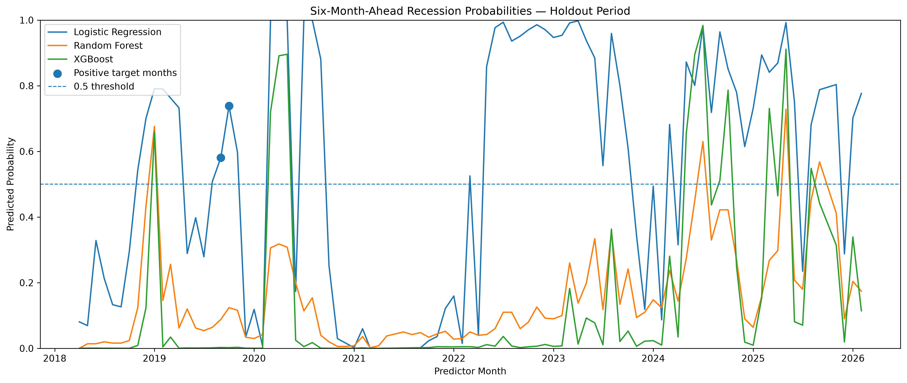
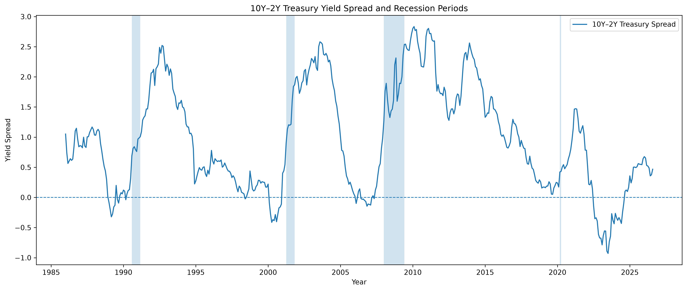
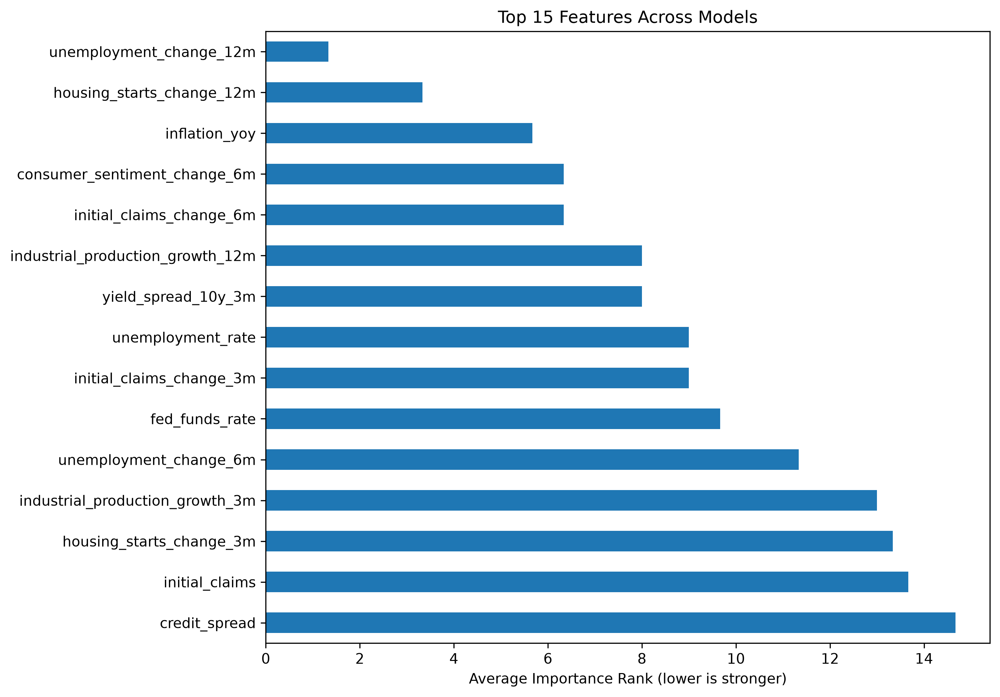
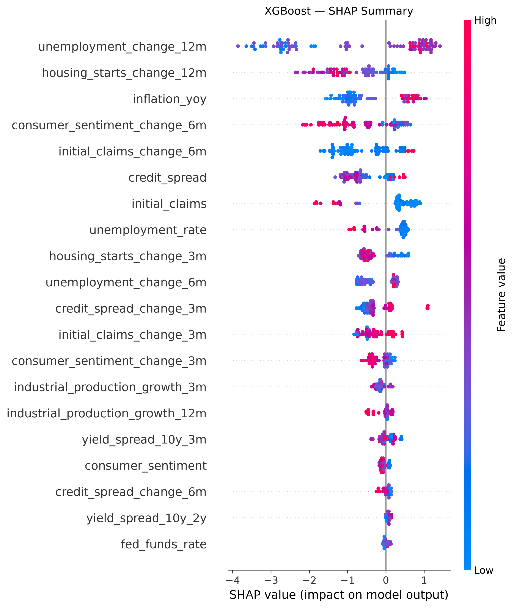

# U.S. Recession Forecasting with Machine Learning

An end-to-end machine learning project that uses U.S. macroeconomic data from the Federal Reserve Economic Data (FRED) database to estimate whether the U.S. economy will be in recession **exactly six months ahead**.

The project covers the full workflow from data collection and feature engineering to time-aware model evaluation, model interpretation, live forecasting, and an interactive Streamlit dashboard.

## Live Forecasting Dashboard

The Streamlit dashboard downloads the latest available FRED data and generates current six-month-ahead estimates using three models:

- Logistic Regression
- Random Forest
- XGBoost

The models are displayed separately because the project does not establish a validated ensemble weighting.



## Project Overview

The main question is:

> **Can macroeconomic indicators predict whether the U.S. economy will be in recession exactly six months later?**

Monthly economic indicators are collected from FRED and transformed into a set of 23 predictor features. The models are evaluated chronologically rather than with a random train/test split so that future observations are not used to predict the past.

The final project includes:

- automated FRED data collection
- monthly preprocessing
- exploratory data analysis
- time-series feature engineering
- Logistic Regression, Random Forest, and XGBoost
- chronological holdout evaluation
- expanding-window time-series cross-validation
- imbalance-aware evaluation metrics
- feature importance and SHAP interpretation
- live six-month-ahead forecasting
- an interactive Streamlit dashboard

## Data

The project uses the following FRED series:

| Indicator | FRED series |
|---|---|
| Unemployment rate | `UNRATE` |
| Initial unemployment claims | `ICSA` |
| Consumer Price Index | `CPIAUCSL` |
| Federal funds rate | `FEDFUNDS` |
| 10Y–2Y Treasury spread | `T10Y2Y` |
| 10Y–3M Treasury spread | `T10Y3M` |
| Industrial production | `INDPRO` |
| Housing starts | `HOUST` |
| Consumer sentiment | `UMCSENT` |
| Baa corporate bond spread | `BAA10Y` |
| U.S. recession indicator | `USREC` |

The S&P 500 series was initially collected but excluded from the final feature set because the available FRED history began much later than the other indicators.

The engineered historical dataset used for the main analysis contains **469 monthly observations and 23 predictor features**, beginning in 1987.

## Exploratory Analysis

The analysis examines recession periods alongside labor-market, yield-curve, housing, sentiment, credit, and other macroeconomic indicators.

One motivation for the forecasting setup is the relationship between the Treasury yield curve and subsequent economic activity.



The exploratory analysis also highlights an important modeling challenge: recession observations are rare. In the processed historical data, only a small share of months are classified as recessions, so accuracy alone can be misleading.

## Feature Engineering

Features are constructed only from information associated with the predictor month and earlier observations.

Examples include:

- unemployment changes over 3, 6, and 12 months
- changes in initial unemployment claims
- year-over-year inflation
- industrial production growth
- changes in housing starts
- consumer sentiment changes
- 10Y–2Y and 10Y–3M yield-curve inversion indicators
- changes in credit spreads
- current macroeconomic levels

The target is created as:

```python
recession_6m = recession.shift(-6)
```

A predictor row from month \(t\) therefore asks whether the economy is classified as being in recession at month \(t+6\).

## Modeling

Three machine learning models are compared:

### Logistic Regression

A standardized Logistic Regression model with balanced class weights provides an interpretable linear benchmark.

### Random Forest

A class-balanced Random Forest captures nonlinear relationships and interactions between macroeconomic indicators.

### XGBoost

XGBoost is trained using a class-imbalance weight calculated from the training data.

### Validation strategy

The dataset is split chronologically:

- first 80%: training data
- final 20%: holdout test data

No random shuffling is used.

The models are also examined using expanding-window `TimeSeriesSplit`. Folds containing only one target class are skipped because several classification metrics are not meaningful in those folds.

Because recession months are rare, evaluation includes:

- Precision
- Recall
- F1
- ROC-AUC
- PR-AUC

rather than relying on accuracy alone.

## Holdout Results

The historical holdout set contains 94 observations but only **2 positive recession-target observations**, making the results highly sensitive to individual episodes.

| Model | Accuracy | Precision | Recall | F1 | ROC-AUC | PR-AUC |
|---|---:|---:|---:|---:|---:|---:|
| Baseline | 0.979 | 0.000 | 0.000 | 0.000 | 0.500 | 0.021 |
| Logistic Regression | 0.436 | 0.036 | 1.000 | 0.070 | 0.522 | 0.032 |
| Random Forest | 0.936 | 0.000 | 0.000 | 0.000 | 0.500 | 0.030 |
| XGBoost | 0.851 | 0.000 | 0.000 | 0.000 | 0.321 | 0.023 |

The baseline achieves very high accuracy simply by predicting the majority class, illustrating why accuracy is not sufficient for this problem.

Logistic Regression identifies both positive holdout observations but produces many false positives. Random Forest and XGBoost miss both positive observations at the default 0.5 classification threshold.

These results do **not** establish a single best forecasting model. Performance varies substantially across historical periods, and the small number of recession episodes creates considerable uncertainty.

## Model Interpretation

Feature importance is compared across the three model families.



Across the project analysis, features such as the 12-month change in unemployment and the 12-month change in housing starts appear prominently, with inflation, changes in initial claims, consumer sentiment, and yield-curve information also contributing.

Feature importance describes how the fitted models use variables. It should not be interpreted as evidence of economic causality.

### SHAP

SHAP is used to inspect the XGBoost model and understand how individual features influence its predictions.



## Live Forecast

The reusable forecasting pipeline in `src/predict.py`:

1. downloads the latest available FRED observations
2. converts the series to monthly data
3. recreates the same engineered predictors used during development
4. trains the three models using observations whose six-month-ahead targets are known
5. finds the newest month with a complete set of predictors
6. produces a six-month-ahead probability from each model

Run the forecast from the project root:

```bash
python src/predict.py
```

The output reports the latest complete data month, the corresponding forecast target month, and separate probabilities for Logistic Regression, Random Forest, and XGBoost.

The probabilities are deliberately not averaged because an ensemble weighting has not been validated.

## Streamlit Dashboard

The dashboard provides a visual interface for the live forecasting pipeline, including:

- current model estimates
- forecast horizon and target month
- comparison between models
- historical holdout probability paths
- selected latest model inputs
- cross-model feature importance
- methodology and limitations

Run locally with:

```bash
python -m streamlit run app.py
```

## Project Structure

```text
recession-forecasting-ml/
├── app.py
├── README.md
├── requirements.txt
├── data/
│   ├── raw/
│   └── processed/
├── figures/
│   ├── yield_curve_recessions.png
│   ├── model_probabilities.png
│   ├── feature_importance.png
│   └── shap_summary.png
├── notebooks/
│   ├── 01_data_collection.ipynb
│   ├── 02_exploratory_analysis.ipynb
│   ├── 03_feature_engineering.ipynb
│   ├── 04_modeling.ipynb
│   └── 05_interpretation.ipynb
└── src/
    ├── data.py
    ├── features.py
    ├── models.py
    ├── evaluation.py
    └── predict.py
```

## Installation

Clone the repository and install the dependencies:

```bash
git clone <repository-url>
cd recession-forecasting-ml
python -m pip install -r requirements.txt
```

Create a `.env` file in the project root:

```text
FRED_API_KEY=your_fred_api_key
```

The `.env` file is excluded from Git and should never be committed.

Then run the notebooks in order or launch the dashboard:

```bash
python -m streamlit run app.py
```

## Limitations

This project is designed as a machine learning and data science study rather than a production macroeconomic forecasting system.

Important limitations include:

- The historical sample contains only a small number of U.S. recession episodes.
- Recession observations are strongly imbalanced relative to expansion observations.
- FRED observations are current/revised data rather than historical real-time vintages.
- Publication lags are not fully modeled.
- Economic relationships may change over time.
- Extreme events such as the 2020 recession can differ substantially from patterns learned from earlier periods.
- The target represents recession status **exactly six months later**, not whether a recession occurs at any point during the following six months.
- A stricter real-time historical evaluation could introduce a six-month purge gap around training and validation boundaries.

A future version could use ALFRED real-time vintages, compare multiple forecast horizons, introduce purged time-series validation, and evaluate probability calibration.

## Technologies

`Python` · `pandas` · `NumPy` · `scikit-learn` · `XGBoost` · `SHAP` · `FRED API` · `Streamlit` · `Matplotlib` · `Seaborn`

